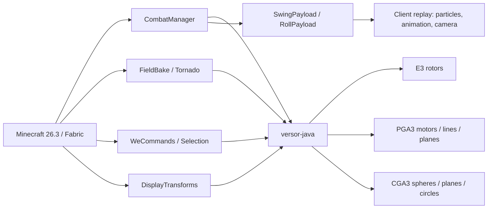

# Versor Geometric Motion Combat

**Geometric algebra, made playable.**

A Fabric mod for **Minecraft 26.3** that uses projective and conformal geometric
algebra for server-authoritative combat, rigid-body motion, physical fields, and
in-game world editing.

[](https://github.com/GBLMX/Versor-Geometric-Motion-Combat/actions/workflows/build.yml)


[中文说明](README.zh-CN.md) · [Documentation](docs/README.md) · [Commands](docs/COMMANDS.md) · [Architecture](docs/ARCHITECTURE.md) · [Math](docs/MATH_PHYSICS.md)

---

## Why this project

Most combat mods author hitboxes, knockback, and animation as separate systems.
This project instead derives them from a shared geometric model:

- **PGA3** represents points, planes, lines, and rigid motions as algebra
  elements. A sword arc, a shield plane, and a dodge rotor use the same
  primitives.
- **Server authority** decides hits, parries, rolls, and edits; clients only
  replay the baked geometry. A hacked client cannot widen its arc.
- **The math core is reusable.** [`versor-java`](https://github.com/GBLMX/versor-java)
  is a pure-Java geometric algebra library with dense, sparse, batch, and
  matrix paths and its own test/benchmark suite.

The result is a combat system whose visuals, collision checks, and network
payloads all come from the same baked arc.

## Features

| Area | What it does |
|---|---|
| **Sweeping attacks** | A 48-point PGA blade arc is baked from the server's eye position and yaw. Segment–AABB distance uses ternary search, so targets cannot tunnel between samples. |
| **Parry** | The attacker's baked arc is intersected with the defender's **guard plane** in PGA. A successful parry cancels the whole attack and pushes the attacker back. |
| **Dodge roll** | Server-side impulse, invulnerability window, cooldown, and a synced rotor animation. |
| **Field effects** | Divergence-free vortex particles and an analytic Rankine-vortex tornado, baked once and replayed by clients. |
| **Geometric editing** | A bounded WorldEdit-style core: selection, set/replace, spheres, cylinders, copy/cut/paste, undo/redo. |
| **Display entities** | Full `transformation` read/write, including independent left/right rotations, translation, and scale. |
| **Camera feedback** | Roll tilt and damage-scaled shake, injected through client render state. |
| **Math library** | E3 rotors, PGA3 motors, CGA3 spheres/planes/circles, twist kinematics, vector calculus, and kernel scheduling. |

## Architecture



Read [Architecture](docs/ARCHITECTURE.md) for module boundaries, authority flow,
networking, and the 26.3 render-pipeline notes.

## Quick start

### Requirements

| Component | Version |
|---|---|
| Minecraft | 26.3 |
| Java | 25 |
| Fabric Loader | 0.19.5 |
| Fabric API | 0.163.0+26.3 |
| Cloth Config | 26.3.159 |
| Mod Menu | 21.0.0 (optional) |

### Build from source

```bash
git clone --recursive https://github.com/GBLMX/Versor-Geometric-Motion-Combat.git
cd Versor-Geometric-Motion-Combat

# JDK 25 must be on JAVA_HOME
./gradlew build
```

The mod jar is written to:

```text
build/libs/versor-geometric-motion-combat-0.1.0.jar
```

If the repository was cloned without submodules:

```bash
git submodule update --init --recursive
```

### Run a development client/server

```bash
./gradlew runClient
./gradlew runServer
```

The dev client disables `xvfb` for local visual testing. CI uses headless build
and test tasks only.

## Installation

1. Install Fabric Loader for Minecraft 26.3.
2. Put **Fabric API**, **Cloth Config**, and this mod jar in `mods/`.
3. Optionally add **Mod Menu** for the in-game configuration screen.
4. Start the game. The mod is server-authoritative; on a dedicated server the
   jar must be installed on the server, and clients need it for visuals.

## Commands

All commands are available as `/versor ...` and `/vm ...`.

| Command | Purpose |
|---|---|
| `/versor attack` | Swing once; server adjudicates the arc and broadcasts it. |
| `/versor roll` | Dodge roll with impulse, invulnerability, and cooldown. |
| `/versor field at <pos>` | Print swirl field, divergence, and curl at a position. |
| `/versor field burst <pos>` | Bake and play a divergence-free vortex burst. |
| `/versor field tornado <pos>` | Spawn a Rankine-vortex tornado. |
| `/versor motion rotation <axis> <omega> <time> <point>` | Print position, velocity, and acceleration. |
| `/versor sweep rotation <axis> <omega> <t0> <t1> <samples> <point>` | Print swept AABB and path length. |
| `/versor display rotate <targets> <axis> <angle> [local]` | Apply an E3 rotor to Display entities. |
| `/versor rules` | Print the active combat tuning. |
| `/we ...` / `//...` | WorldEdit-style editing commands. |

Full syntax, permissions, and examples: [Commands](docs/COMMANDS.md).

## Configuration

Combat tuning is a datapack file:

```text
data/versormotion/combat.json
```

It is reloaded with `/reload`. Missing or malformed values fall back to defaults;
all numbers are clamped.

| Key | Default | Range | Meaning |
|---|---:|---:|---|
| `arc_damage` | 2.0 | 0–100 | Base damage for a swept hit. |
| `knockback` | 0.3 | 0–5 | Horizontal knockback strength. |
| `swing_cooldown_ticks` | 4 | 0–200 | Minimum ticks between adjudicated swings. |
| `swing_ticks` | 6 | 1–40 | Client trail lifetime. |
| `min_reach` | 2.0 | 1.0–6.0 | Lower bound for entity interaction range. |
| `max_reach` | 6.0 | 2.0–8.0 | Upper bound for entity interaction range. |
| `parry` | true | bool | Enable guard-plane parries. |
| `parry_reach` | 1.15 | 0.5–4.0 | Shield coverage radius. |
| `field_seeds` | 10 | 1–64 | Vortex seed count. |
| `field_steps` | 6 | 1–32 | Vortex integration steps per seed. |
| `field_ticks` | 10 | 1–60 | Particle effect lifetime. |

See [Configuration](docs/CONFIGURATION.md) for reload behavior and datapack
placement.

## Testing

The repository has three standalone test suites in addition to the Gradle build:

```bash
./gradlew gaTest        # 454 geometric-algebra checks
./gradlew combatTest    # 245 combat/field/rule checks
./gradlew weTest        # 38 selection/shape/clipboard/undo checks
./gradlew build         # compile + package
```

The math core also has dense, sparse, batch, matrix, JMH, and multicore
benchmarks. See [`lib/versor-java/PERFORMANCE.md`](lib/versor-java/PERFORMANCE.md)
and [`lib/versor-java/docs/KERNEL_SCHEDULING.md`](lib/versor-java/docs/KERNEL_SCHEDULING.md).

## Visualization

[`tools/manim/`](tools/manim/README.md) contains the fixed ManimGL environment
(`pyproject.toml` + `uv.lock`), `versor_ga` (a small E3/PGA/CGA library for scene
authoring), an E3 rotor scene driven by `versor-java`, and the migrated STA/Cl(1,3)
scene. The `versor_ga.KDE` palette follows the active KDE CachyOS Nord scheme and
the fish/zsh syntax colors. Run the integration test with:

```bash
cd tools/manim
./test.sh
```

It runs the 454 algebra checks, exports 61 samples from `vsr.E3`, and renders
`videos/VersorRotor.mp4`.

## Benchmarks

[`tools/bench-ga/`](tools/bench-ga/README.md) compares `versor-java` with
`clifford` and `kingdon` on identical Cl(3,0) and Cl(4,1) workloads:

```bash
cd tools/bench-ga
./run.sh
```

It reports dense geometric product, rotor sandwich, and 1000-element batch
sandwich in ns per element. The harness pins Python 3.13 and writes
`results.csv`; generated results are not committed.

## Project layout

```text
src/main/java/com/gblmx/versormotion/
  CombatManager.java       server-authoritative swing adjudication
  RollManager.java         dodge-roll state and cooldown
  FluidDrag.java           quadratic hydrodynamic drag
  combat/                  arc sweep, guard plane, rules
  field/                   vortex and tornado baking
  wedit/                   bounded WorldEdit-style core
  net/                     S2C payloads
src/client/java/...        rendering, animation, camera, particles
src/main/resources/        mod metadata, mixins, datapack defaults
src/test/java/...          standalone combat/we checks
lib/versor-java/           pure-Java geometric algebra core (submodule)
tools/manim/               fixed uv/ManimGL scenes and versor-java bridge
tools/bench-ga/            cross-library GA benchmark
docs/                      architecture, commands, math, development
```

## Compatibility and limits

- **Minecraft 26.3 / Java 25 only.** The render code targets the 26.3
  `renderpearl` pipeline; older versions are not supported.
- **Server-authoritative by design.** Client-only installation gives no combat
  advantage and may miss visuals.
- **WorldEdit-style editing is intentionally bounded.** One command touches at
  most 32,768 blocks; radius ≤ 32; cylinder height ≤ 64. NBT, schematics,
  region files, and multi-point selections are not implemented.
- **`//` prefix conflict.** The `//command` hook claims that prefix, so it
  conflicts with WorldEdit and similar mods. Use one at a time.
- **Apache-2.0.** See [LICENSE](LICENSE) and [NOTICE](NOTICE).

## Documentation

| Document | Contents |
|---|---|
| [Documentation index](docs/README.md) | Map of all docs. |
| [Architecture](docs/ARCHITECTURE.md) | Modules, authority, networking, rendering. |
| [Commands](docs/COMMANDS.md) | `/versor` and `/we` reference. |
| [Combat](docs/COMBAT.md) | Arc, parry, roll, damage, compatibility. |
| [Configuration](docs/CONFIGURATION.md) | `combat.json` and reload behavior. |
| [Math and physics](docs/MATH_PHYSICS.md) | GA, PGA/CGA, kinematics, fields, fluid. |
| [Kernel scheduling](lib/versor-java/docs/KERNEL_SCHEDULING.md) | Dense/sparse/batch/matrix dispatch. |
| [Development](docs/DEVELOPMENT.md) | Build, test, submodule, CI, debugging. |
| [Roadmap](docs/ROADMAP.md) | Current scope and next steps. |

## Contributing

Issues and pull requests are welcome. Please read
[CONTRIBUTING.md](CONTRIBUTING.md) before opening a PR. In short:

1. Open an issue for behavior changes or compatibility work.
2. Keep changes focused; include the narrowest relevant test.
3. Run `./gradlew gaTest combatTest weTest build` before pushing.
4. Update docs when a command, config key, or payload changes.

For security issues, follow [SECURITY.md](SECURITY.md) instead of opening a
public issue.

## References

| Source | Use |
|---|---|
| [`versor-java`](https://github.com/GBLMX/versor-java) | Geometric algebra core. |
| Macdonald, *Linear and Geometric Algebra* | Rotors and interpolation. |
| Macdonald, *Vector and Geometric Calculus* | Vector derivative, flux. |
| [Klein](https://github.com/jeremyong/klein) | PGA scalar conventions and sign tables. |
| [Aerodynamics4MC-Core](https://github.com/MozillaFiredoge/Aerodynamics4MC-Core) | Thin entrypoints, server authority, quantized sync. |

## License

Apache License 2.0. See [LICENSE](LICENSE) and [NOTICE](NOTICE).
