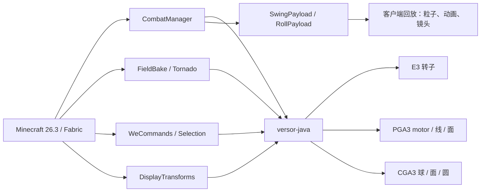

# Versor Geometric Motion Combat

**让几何代数真正可玩。**

面向 **Minecraft 26.3** 的 Fabric 模组：用投影/共形几何代数实现服务端权威的战斗、
刚体运动、物理场与游戏内编辑。

[](https://github.com/GBLMX/Versor-Geometric-Motion-Combat/actions/workflows/build.yml)


[English](README.md) · [文档索引](docs/README.md) · [命令](docs/COMMANDS.md) · [架构](docs/ARCHITECTURE.md) · [数学物理](docs/MATH_PHYSICS.md)

---

## 为什么做这个项目

多数战斗模组把命中盒、击退和动画当作三套独立系统。本项目把它们统一到一套
几何模型上：

- **PGA3** 用代数元素表示点、平面、直线和刚体运动；刀弧、盾面和翻滚转子共享
  同一套原语。
- **服务端权威**：命中、格挡、翻滚和编辑由服务器判定，客户端只回放烘焙后的
  几何。改客户端不能扩大刀弧。
- **数学核心可复用**：[`versor-java`](https://github.com/GBLMX/versor-java)
  是纯 Java 几何代数库，包含稠密、稀疏、批量和矩阵路径，并有独立测试/基准。

视觉、碰撞检测和网络数据都来自同一条烘焙刀弧。

## 功能

| 模块 | 内容 |
|---|---|
| **挥砍** | 从服务器眼位/朝向烘焙 48 点 PGA 刀弧；段–AABB 距离用三分搜索，目标无法在采样点之间穿透。 |
| **盾反** | 刀弧与防守者盾面（PGA 平面）求交；命中后取消整次攻击并击退攻击者。 |
| **翻滚** | 服务端冲量、无敌帧、冷却，以及同步的转子动画。 |
| **场效果** | 无散度涡旋粒子；解析 Rankine 涡龙卷风，一次烘焙、客户端回放。 |
| **几何编辑** | 有界的 WorldEdit 风格核心：选区、set/replace、球/圆柱、copy/cut/paste、undo/redo。 |
| **Display 实体** | 完整 `transformation` 读写，左右旋转、平移、缩放互不覆盖。 |
| **镜头反馈** | 翻滚侧倾、按伤害衰减的镜头抖动。 |
| **数学库** | E3 转子、PGA3 motor、CGA3 球/面/圆、twist 运动学、矢量微积分、内核调度。 |

## 架构



模块边界、权威流、网络包和 26.3 渲染管线说明见 [架构文档](docs/ARCHITECTURE.md)。

## 快速开始

### 环境

| 组件 | 版本 |
|---|---|
| Minecraft | 26.3 |
| Java | 25 |
| Fabric Loader | 0.19.5 |
| Fabric API | 0.163.0+26.3 |
| Cloth Config | 26.3.159 |
| Mod Menu | 21.0.0（可选） |

### 从源码构建

```bash
git clone --recursive https://github.com/GBLMX/Versor-Geometric-Motion-Combat.git
cd Versor-Geometric-Motion-Combat

# 需要 JDK 25，并设置 JAVA_HOME
./gradlew build
```

产物：

```text
build/libs/versor-geometric-motion-combat-0.1.0.jar
```

如果 clone 时没有带子模块：

```bash
git submodule update --init --recursive
```

### 启动开发客户端/服务端

```bash
./gradlew runClient
./gradlew runServer
```

本地开发客户端关闭了 `xvfb`；CI 只运行无头构建和测试。

## 安装

1. 为 Minecraft 26.3 安装 Fabric Loader。
2. 把 **Fabric API**、**Cloth Config** 和本模组 jar 放进 `mods/`。
3. 可选安装 **Mod Menu** 以获得游戏内配置界面。
4. 启动游戏。模组是服务端权威的：专用服务器必须安装，客户端安装后才能看到完整
   粒子/动画表现。

## 命令

命令同时注册为 `/versor ...` 和 `/vm ...`。

| 命令 | 作用 |
|---|---|
| `/versor attack` | 挥砍一次；服务器判定刀弧并广播。 |
| `/versor roll` | 翻滚：冲量、无敌帧、冷却。 |
| `/versor field at <pos>` | 输出该点的涡旋场、散度和旋度。 |
| `/versor field burst <pos>` | 烘焙并播放一次无散度涡旋。 |
| `/versor field tornado <pos>` | 生成 Rankine 涡龙卷风。 |
| `/versor motion rotation <axis> <omega> <time> <point>` | 输出位置、速度、加速度。 |
| `/versor sweep rotation <axis> <omega> <t0> <t1> <samples> <point>` | 输出扫掠 AABB 与路径长度。 |
| `/versor display rotate <targets> <axis> <angle> [local]` | 对 Display 实体叠加 E3 转子。 |
| `/versor rules` | 输出当前战斗参数。 |
| `/we ...` / `//...` | WorldEdit 风格编辑命令。 |

完整语法、权限与示例见 [命令文档](docs/COMMANDS.md)。

## 配置

战斗参数是数据包文件：

```text
data/versormotion/combat.json
```

`/reload` 后生效。缺失或格式错误的值回退到默认值，所有数字都会被夹取到安全范围。

| 键 | 默认 | 范围 | 含义 |
|---|---:|---:|---|
| `arc_damage` | 2.0 | 0–100 | 刀弧基础伤害。 |
| `knockback` | 0.3 | 0–5 | 水平击退强度。 |
| `swing_cooldown_ticks` | 4 | 0–200 | 两次判定挥砍的最小间隔。 |
| `swing_ticks` | 6 | 1–40 | 客户端轨迹持续时间。 |
| `min_reach` | 2.0 | 1.0–6.0 | 实体交互距离下限。 |
| `max_reach` | 6.0 | 2.0–8.0 | 实体交互距离上限。 |
| `parry` | true | bool | 是否启用盾反。 |
| `parry_reach` | 1.15 | 0.5–4.0 | 盾牌覆盖半径。 |
| `field_seeds` | 10 | 1–64 | 涡旋种子数。 |
| `field_steps` | 6 | 1–32 | 每个种子的积分步数。 |
| `field_ticks` | 10 | 1–60 | 粒子效果持续时间。 |

数据包放置与重载细节见 [配置文档](docs/CONFIGURATION.md)。

## 测试

除 Gradle 构建外，仓库有三套独立测试：

```bash
./gradlew gaTest        # 454 项几何代数检查
./gradlew combatTest    # 245 项战斗/场/规则检查
./gradlew weTest        # 38 项选区/形体/剪贴板/undo 检查
./gradlew build         # 编译 + 打包
```

数学核心还有稠密、稀疏、批量、矩阵、JMH 和多核基准。详见
[`lib/versor-java/PERFORMANCE.md`](lib/versor-java/PERFORMANCE.md) 和
[`lib/versor-java/docs/KERNEL_SCHEDULING.md`](lib/versor-java/docs/KERNEL_SCHEDULING.md)。

## 可视化

[`tools/manim/`](tools/manim/README.md) 固定了 ManimGL 环境
（`pyproject.toml` + `uv.lock`），包含由 `versor-java` 数据驱动的 E3 转子场景，
以及迁移后的 STA/Cl(1,3) 场景。联调测试：

```bash
cd tools/manim
./test.sh
```

脚本会跑 454 项代数检查、用 `vsr.E3` 导出 61 个采样点，并渲染
`videos/VersorRotor.mp4`。

## 项目结构

```text
src/main/java/com/gblmx/versormotion/
  CombatManager.java       服务端权威挥砍判定
  RollManager.java         翻滚状态与冷却
  FluidDrag.java           二次流体阻力
  combat/                  刀弧、盾面、规则
  field/                   涡旋与龙卷风烘焙
  wedit/                   有界 WorldEdit 风格核心
  net/                     S2C 网络包
src/client/java/...        渲染、动画、镜头、粒子
src/main/resources/        模组元数据、mixin、数据包默认值
src/test/java/...          独立 combat/we 检查
lib/versor-java/           纯 Java 几何代数核心（子模块）
tools/manim/               固定 uv/ManimGL 场景与 versor-java 桥
docs/                      架构、命令、数学、开发文档
```

## 兼容性与限制

- **仅支持 Minecraft 26.3 / Java 25。** 渲染代码针对 26.3 的 `renderpearl`
  管线，旧版本不支持。
- **服务端权威。** 只装客户端不会获得战斗优势，也可能缺少视觉表现。
- **编辑是有界的。** 单条命令最多 32,768 方块；半径 ≤ 32；圆柱高 ≤ 64。
  不支持 NBT、schematic、区域文件和多点选区。
- **`//` 前缀冲突。** `//command`  hook 会占用该前缀，与 WorldEdit 等模组冲突，
  二选一。
- **Apache-2.0。** 见 [LICENSE](LICENSE) 与 [NOTICE](NOTICE)。

## 文档

| 文档 | 内容 |
|---|---|
| [文档索引](docs/README.md) | 全部文档地图。 |
| [架构](docs/ARCHITECTURE.md) | 模块、权威流、网络、渲染。 |
| [命令](docs/COMMANDS.md) | `/versor` 与 `/we` 参考。 |
| [战斗](docs/COMBAT.md) | 刀弧、盾反、翻滚、伤害、兼容性。 |
| [配置](docs/CONFIGURATION.md) | `combat.json` 与重载。 |
| [数学物理](docs/MATH_PHYSICS.md) | GA、PGA/CGA、运动学、场、流体。 |
| [内核调度](lib/versor-java/docs/KERNEL_SCHEDULING.md) | 稠密/稀疏/批量/矩阵分派。 |
| [开发](docs/DEVELOPMENT.md) | 构建、测试、子模块、CI、调试。 |
| [路线图](docs/ROADMAP.md) | 当前范围与下一步。 |

## 贡献

欢迎 issue 和 pull request。提交 PR 前请阅读 [CONTRIBUTING.md](CONTRIBUTING.md)。
简要要求：

1. 行为变更或兼容性工作先开 issue。
2. 保持改动聚焦，并附带最窄的相关测试。
3. 推送前运行 `./gradlew gaTest combatTest weTest build`。
4. 命令、配置键或网络包变化时同步更新文档。

安全问题请按 [SECURITY.md](SECURITY.md) 私下报告，不要开公开 issue。

## 参考资料

| 来源 | 用途 |
|---|---|
| [`versor-java`](https://github.com/GBLMX/versor-java) | 几何代数核心。 |
| Macdonald, *Linear and Geometric Algebra* | 转子与插值。 |
| Macdonald, *Vector and Geometric Calculus* | 矢量导数、通量。 |
| [Klein](https://github.com/jeremyong/klein) | PGA 标量约定与符号表。 |
| [Aerodynamics4MC-Core](https://github.com/MozillaFiredoge/Aerodynamics4MC-Core) | 薄入口、服务端权威、量化同步。 |

## 许可证

Apache License 2.0。见 [LICENSE](LICENSE) 与 [NOTICE](NOTICE)。
