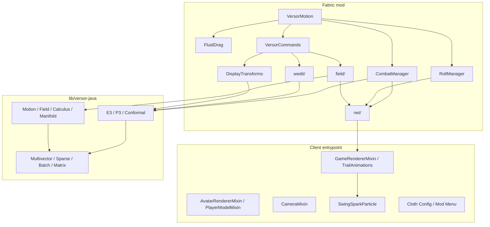
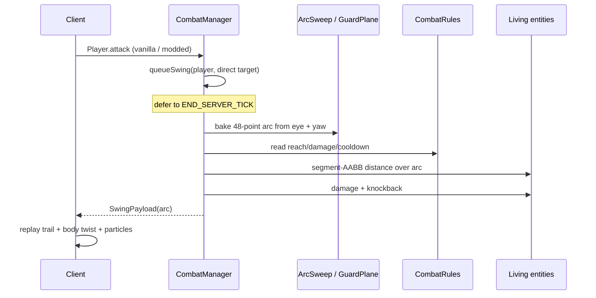

# Architecture

## Design goals

1. **One geometric model.** Combat arcs, guard planes, motions, fields, and
   Display transforms use elements from the same algebra.
2. **Server authority.** Hit, parry, roll, and edit decisions run on the server.
   Clients replay baked results; they do not recompute the hit volume.
3. **Reusable math core.** Minecraft-specific code stays thin; the geometric
   algebra lives in the `versor-java` submodule with its own tests and benchmarks.
4. **Bounded work.** Commands clamp reach, block volume, and particle counts so a
   datapack or command block cannot allocate unbounded geometry.

## Module map



## Server authority flow

### Swing adjudication



Why defer to the end of the tick: a multi-target attack handler can call
`Player.attack` several times in one tick. Deferring lets the arc exclude every
direct target from that tick, so one entity cannot take both a vanilla direct hit
and an extra arc hit. The arc, reach, and attack-strength scale are captured at
queue time; the world state at flush time is used for damage.

### Parry

A parry is checked before the swing is queued. It requires:

1. The defender is blocking and carries a `blocks_attacks` component.
2. The damage type is not in the component's `bypassed_by` set.
3. The defender's look vector points toward the attacker (`dot > 0.45`).
4. The baked arc crosses the defender's guard plane inside the parry reach.

The guard plane is the PGA plane through the defender's eye with the defender's
look vector as normal. The crossing is the PGA meet `plane ∧ line` for each arc
segment. A hit cancels the whole attack and pushes the attacker back.

### Roll

`RollManager` stores per-player cooldown timestamps, applies a horizontal
look-directed impulse of `0.6` blocks/tick, preserves non-negative vertical
velocity, grants 10 ticks of invulnerability, and broadcasts `RollPayload`.
Disconnect cleanup removes cooldown state.

## Field pipeline

`StreamBake` takes the curl of a scalar stream function, producing a
divergence-free horizontal vortex. `TornadoBake` integrates an analytic Rankine
vortex with radial inflow and an axis updraft. Both bake a deterministic point
list on the server:

```text
seed ring -> normalized field step -> fixed number of points -> payload
```

`FieldBurst` and `Tornado` broadcast the points once; the client interpolates,
fades, and emits particles from the same cloud. The server does not tick the
particle geometry.

## Editing core

`wedit` is intentionally not a full WorldEdit implementation:

- `Selection` stores two corners per player.
- `Shapes` enumerates sphere/cylinder positions.
- `Clipboard` and `History` are per-player and capped.
- `WeCommands` enforces `MAX_VOLUME = 32768`, `MAX_RADIUS = 32`, `MAX_HEIGHT = 64`.
- A mixin translates `//command` into `we command` before dispatch.

Edits are applied through the server level and recorded in a bounded undo
history. No schematic, NBT, or region-file support is claimed.

## Networking

| Payload | Direction | Purpose |
|---|---|---|
| `SwingPayload` | S2C | Entity id, trail ticks, baked arc points. |
| `RollPayload` | S2C | Entity id and roll duration. |
| `FieldBurstPayload` | S2C | Baked vortex points. |
| `TornadoPayload` | S2C | Baked funnel points and lifetime. |
| `CameraShakePayload` | S2C | Shake intensity and duration. |

Payloads are registered in `net/Payloads.java`. Clients use them for visuals only;
they are never trusted for damage decisions.

## Client presentation

- `TrailAnimations` and `SwingSparkParticle` render the baked arc and impact sparks.
- `AvatarRendererMixin` / `PlayerModelMixin` add roll rotation and limb tuck.
- `CameraMixin` adds roll tilt and damage shake.
- `SwingSparkParticle` is a custom `versormotion:swing_spark` particle.
- Cloth Config / Mod Menu expose client settings.

## 26.3 render note

Minecraft 26.3 moved the render stack from `com.mojang.blaze3d.*` to
`com.mojang.renderpearl.*`:

```java
import com.mojang.renderpearl.api.pipeline.RenderPipeline;
import com.mojang.renderpearl.api.pipeline.PrimitiveTopology;
import com.mojang.renderpearl.api.commands.RenderPass;
import com.mojang.renderpearl.api.textures.GpuTextureView;
import com.mojang.renderpearl.api.vertex.VertexFormat;
import com.mojang.renderpearl.api.buffers.GpuBufferSlice;
```

`RenderPass.setPipeline` takes a `CompiledRenderPipeline` obtained from
`RenderSystem.getCompiledPipeline(...)`. The extraction/drawing split uses a
`StagedVertexBuffer`; `upload()` must not be called inside an existing render
pass. The client render event is registered at `LevelRenderEvents.END_MAIN`
because `AFTER_TRANSLUCENT_TERRAIN` is still inside the main pass and triggers
`"Close the existing render pass before performing additional commands"`.

## Math core boundaries

The mod depends on `lib/versor-java` through source-set inclusion, not a published
artifact. The core has no Minecraft dependency and can be built standalone:

```bash
cd lib/versor-java
./build.sh
```

The main layers are documented in [Math and physics](MATH_PHYSICS.md) and
[Kernel scheduling](../lib/versor-java/docs/KERNEL_SCHEDULING.md).
